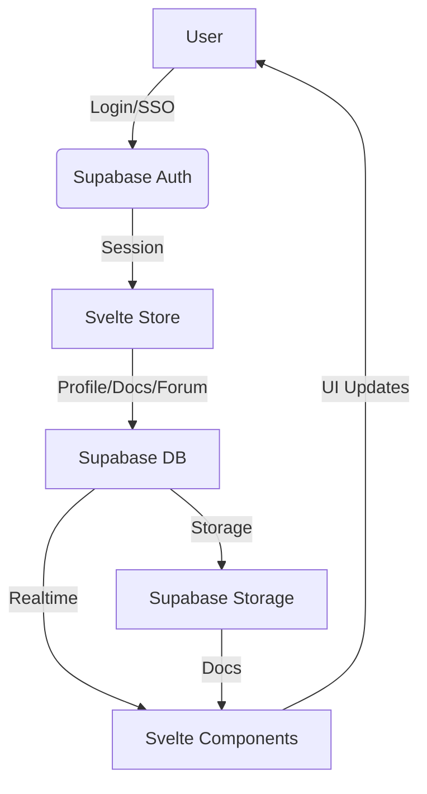

# amjur.org Svelte + TailwindCSS4 SPA — Design Overview

> **Note:** Research on Svelte 5, TailwindCSS4, authentication, and integration best practices is complete. See TODO.md for summary and PLAN.md for implementation alignment.

## 1. Current Supabase Schema & Capabilities

### Schemas
- **api**: Application data (profiles, education, experience, skills, blog_posts, membership, collaborations, documents, forum, amendments, etc.)
- **auth**: Authentication, SSO, MFA, sessions, identities, tokens, and audit logs.

### Key Tables (api schema)
- **profiles**: User profile (id, email, full_name, title, firm_name, location, bio, avatar_url, linkedin_url, website_url, phone, created_at, updated_at, nom_de_plume)
- **education**: Education history (id, user_id, institution, degree, field_of_study, start_date, end_date, description, created_at)
- **experience**: Work experience (id, user_id, company, position, location, start_date, end_date, current_position, description, created_at)
- **skills**: Skills (id, user_id, skill_name, proficiency, created_at)
- **blog_posts**: Blog posts (id, author_id, title, content, excerpt, slug, status, tags, featured_image_url, published_at, created_at, updated_at)
- **membership**: Membership status (id, user_id, status, tier, history, created_at, updated_at)
- **collaborations**: Collaboration projects (id, creator_id, title, description, created_at)
- **forum_posts**: Forum posts (id, author_id, content, created_at)
- **writings**: User writings (id, author_id, nom_de_plume, title, content, status, addenda, created_at, published_at)
- **documents**: Documents (id, title, content, author_id, created_at, updated_at)
- **citations**: Document citations (id, source_document_id, target_document_id, citing_user_id, created_at)
- **citation_metrics**: Citation metrics (id, document_id, citation_count, h_index, updated_at)
- **amendments**: Document amendments (id, document_id, proposer_id, content, status, created_at, updated_at, reviewed_at, merged_at, reviewer_id)
- **audit_log**: Audit logs (id, user_id, action, table_name, record_id, changes, created_at)

#### Relationships
- Most tables reference `profiles.id` as a foreign key.
- `profiles.id` is linked to `auth.users.id`.
- Documented foreign keys for education, experience, skills, blog_posts, membership, collaborations, forum_posts, writings, documents, citations, amendments, and audit_log.

### Key Tables (auth schema)
- **users**: Core user accounts (id, email, phone, role, meta, SSO, MFA, etc.)
- **identities**: Linked identities (provider, user_id, identity_data)
- **sessions**: User sessions (id, user_id, factor_id, aal, etc.)
- **mfa_factors**, **mfa_challenges**, **mfa_amr_claims**: Multi-factor authentication
- **sso_providers**, **sso_domains**, **saml_providers**, **saml_relay_states**: SSO/SAML support
- **refresh_tokens**, **one_time_tokens**: Token management
- **audit_log_entries**: Auth audit trail

### Auth Features
- Password, magic link, SSO (SAML, Google, Azure, Okta), MFA, session management, roles, audit logging.
- Row Level Security (RLS) enabled on sensitive tables.

---

## 2. UI/UX & Architecture Recommendations

### User Experience & Flows
- **Profile-centric navigation** with sections for education, experience, skills, blog posts, documents, collaborations, and forum.
- **Progressive onboarding** after registration, prompting profile completion.
- **Role-based dashboards** using Supabase roles and RLS.
- **Real-time collaboration** for forums, documents, and amendments.

### Authentication & Authorization
- Use Supabase Auth for password, magic link, SSO, and social logins.
- Enable SSO for organizations and MFA for sensitive actions.
- JWT-based sessions with configurable lifetimes.
- Store roles in a `user_roles` table and enforce with RLS.
- Onboarding flow checks profile completeness post-signup.

### Svelte Component & State Architecture
- Modular components: `Profile.svelte`, `Education.svelte`, `Experience.svelte`, `Skills.svelte`, `BlogPosts.svelte`, `Documents.svelte`, `Forum.svelte`, etc.
- Layout component for navigation and auth state.
- Svelte stores for global state (auth, user, notifications), derived stores for computed state.
- Subscribe to Supabase channels for real-time updates.
- RLS for all tables, validate actions on client and server.

### UI/UX Patterns & Pitfalls
- Professional branding, verification status, privacy controls, audit logs.
- Accessibility (WCAG 2.1 AA), semantic HTML, ARIA roles.
- Avoid notification overload, default to private/sharing opt-in, careful document versioning.

---

## 3. Reference Architecture

---

## 4. Key Supabase Docs

- [Auth](https://supabase.com/docs/guides/auth)
- [Enterprise SSO](https://supabase.com/docs/guides/auth/enterprise-sso)
- [Sessions](https://supabase.com/docs/guides/auth/sessions)
- [Securing your data](https://supabase.com/docs/guides/database/secure-data)
- [Row Level Security](https://supabase.com/docs/guides/database/postgres/row-level-security)